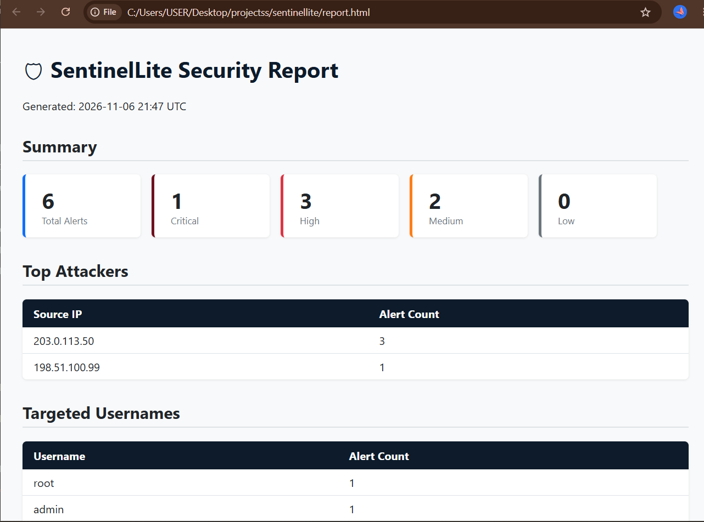

# SentinelLite

A Python-only mini-SIEM for SSH auth.log analysis. Portfolio project — one-day build, Windows 11, no Docker, no external databases.

---

## Architecture

```
sentinellite/
├── src/sentinellite/
│   ├── models.py          # Pydantic Event + Alert
│   ├── parsers/
│   │   ├── base.py        # Abstract parser interface
│   │   └── ssh_auth.py    # OpenSSH auth.log parser
│   ├── detection/
│   │   ├── engine.py      # Sliding-window rule engine
│   │   └── rules.yaml     # Thresholds (no hardcoding)
│   ├── storage.py         # SQLite (parameterised queries)
│   ├── report.py          # Self-contained HTML report
│   ├── cli.py             # argparse CLI
│   └── api.py             # FastAPI on 127.0.0.1:8000
├── tools/
│   └── log_simulator.py   # Generates realistic test logs
└── tests/
    ├── fixtures/
    │   └── sample_auth.log
    ├── test_parser.py
    ├── test_detection.py
    ├── test_storage.py
    └── test_api.py

Data flow:

  log file
     │
     ▼
  SSHAuthParser  ──► list[Event]
                          │
                          ▼
                   DetectionEngine  ──► list[Alert]
                          │                  │
                          ▼                  ▼
                      storage.py ◄──── save_alerts()
                          │
                     ┌────┴────┐
                     ▼         ▼
                 cli.py     api.py
                 report.py
```

---

## Install & Run (PowerShell)

```powershell
# 1. Generate sample log
$env:PYTHONPATH = "src"
.\.venv\Scripts\python.exe tools\log_simulator.py

# 2. Analyse it — table output + HTML report + SQLite DB
$env:PYTHONPATH = "src"
.\.venv\Scripts\python.exe -m sentinellite.cli `
    --file tests\fixtures\sample_auth.log `
    --format table `
    --report report.html `
    --db sentinel.db

# 3. Start the API server
$env:PYTHONPATH = "src"
.\.venv\Scripts\python.exe -m sentinellite.api
# then open http://127.0.0.1:8000/docs

# 4. Run tests
$env:PYTHONPATH = "src"
.\.venv\Scripts\python.exe -m pytest tests\ -v

# 5. Lint
$env:PYTHONPATH = "src"
.\.venv\Scripts\python.exe -m ruff check src\ tests\
```

> **Override a threshold** without editing YAML:
> ```powershell
> .\.venv\Scripts\python.exe -m sentinellite.cli --file auth.log --threshold brute_force.threshold=5
> ```

---

## Sample Output

```
Parsed 109 events from tests\fixtures\sample_auth.log
Detection complete: 6 alert(s) raised.

ID    Severity   Rule                      MITRE        IP                 User             Risk
----- ---------- ------------------------- ------------ ------------------ --------------- -----
-     high       Brute Force               T1110.001    203.0.113.50       root               70
-     high       Password Spraying         T1110.003    203.0.113.50       multiple           70
-     medium     Credential Stuffing       T1110.004    multiple           alice              45
-     critical   Success After Failure     T1078        198.51.100.99      dave               95
-     medium     Privilege Abuse           T1548.003    unknown            bob                40

[DRY-RUN BLOCKER] The following firewall commands would block high-severity IPs.
Review and run manually in an elevated PowerShell session if desired:

  netsh advfirewall firewall add rule name="SentinelLite-block-203.0.113.50" protocol=TCP dir=in remoteip=203.0.113.50 action=block
```

---

## Risk Score Formula

```
risk_score = base_severity + volume_bonus + recency_bonus

base_severity:  low=10  medium=30  high=60  critical=85
volume_bonus:   min(20, (count // threshold) * 5)
recency_bonus:  10 if last_seen was within the last 5 minutes, else 0

Clamped to [0, 100].
```

Example: brute force, threshold=10, count=20, attack ongoing:
`60 + min(20, 2*5) + 10 = 80`

---

## Detection Rules

| Rule ID | MITRE | Trigger | Default window |
|---|---|---|---|
| `brute_force` | T1110.001 | ≥10 failures from 1 IP | 10 min |
| `password_spraying` | T1110.003 | ≥5 failures, ≥3 distinct users, 1 IP | 10 min |
| `credential_stuffing` | T1110.004 | ≥5 distinct IPs targeting 1 user | 10 min |
| `success_after_failure` | T1078 | ≥3 failures then success, same IP | 30 min |
| `privilege_abuse` | T1548.003 | ≥3 sudo events from 1 user | 60 min |

All thresholds live in `src/sentinellite/detection/rules.yaml`.

---

## Limitations & False Positives

- **No year in syslog timestamps.** We inject the current year, so logs spanning a year boundary will have wrong timestamps for events before Jan 1.
- **IPv6 partial support.** The regex extracts IPv6 candidates; unusual formats may be dropped and logged as `unknown`.
- **Shared NAT/VPN IPs.** A brute-force alert on a corporate egress IP doesn't mean one person is attacking.
- **Missing SPF/DKIM/DMARC** is not scored — this tool only analyses SSH auth logs, not email.
- **`success_after_failure`** fires on slow human typo-then-success too. Treat as a signal to investigate, not proof of compromise.
- **"No alerts"** means no strong indicators were found in the submitted log, not that the system is guaranteed uncompromised.
- **Sudo abuse** threshold is intentional; one sudo is normal. Three in an hour warrants a look.

---

## Design Decisions

**Why stream line-by-line?** Log files can be hundreds of megabytes. Loading into memory would make the tool unusable on real logs.

**Why sliding windows with deques?** A deque pop-left is O(1). Sorting once and scanning once keeps detection O(n) overall rather than O(n²) per rule.

**Why externalise thresholds to YAML?** Hardcoded numbers become tribal knowledge. YAML lets an analyst tune without touching Python.

**Why SQLite?** Zero setup, single file, cross-platform, sufficient for files up to ~10 GB. Postgres would require Docker or a service — ruled out by constraints.

**Why no raw log content in the events table?** Privacy: we only need metadata for correlation. Evidence (capped at 10 lines per alert) lives in the alerts table only, bounded by the Pydantic model.

**Why dry-run only for firewall commands?** The spec forbids `subprocess` calls and elevation. Printing the command lets a human review it before running in an elevated shell.

**Why no CDN in the HTML report?** The report must be viewable offline and must not beacon to external servers when opened.

---

## Screenshots



---

## Roadmap

- **Docker** — containerise the API so the tool runs anywhere without a manual venv setup
- **Redis** — replace the in-process sliding-window state with a Redis stream so multiple workers can share detection state in real time
- **Real-time tail mode** — `--follow` flag that tails a live log file and triggers detection incrementally, like `tail -f` with alerting
- **GeoIP enrichment** — annotate source IPs with country and ASN using a local MaxMind database (no outbound calls)
- **Go agent** — lightweight log-shipping agent written in Go for endpoints that can't run Python; forwards structured events to the FastAPI ingest endpoint
- **Dashboard** — browser-based live dashboard (plain HTML + EventSource / SSE) served by the FastAPI process; no React, no build step
